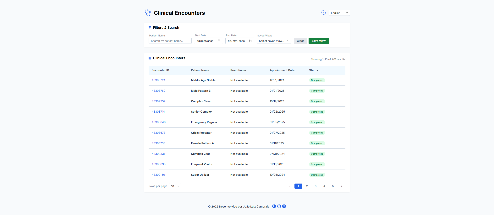
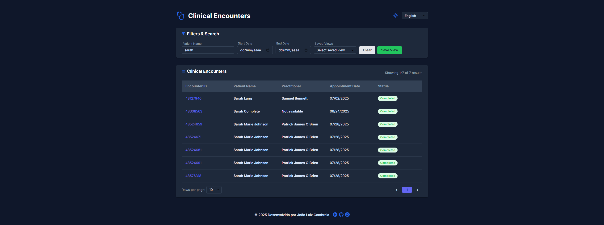
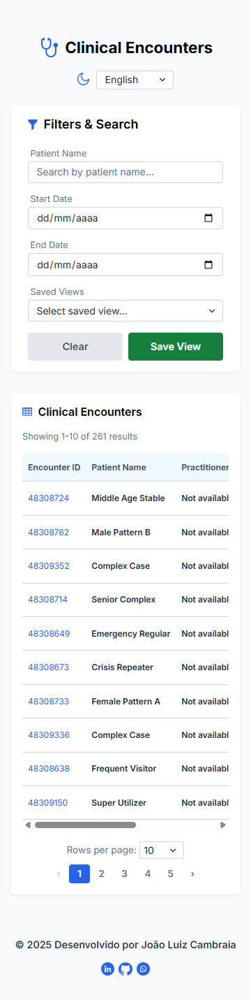
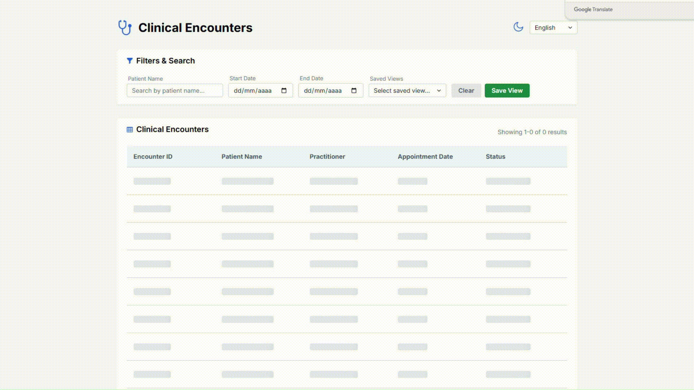
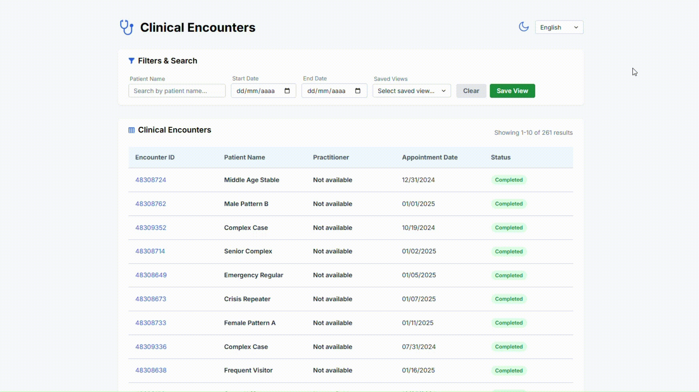
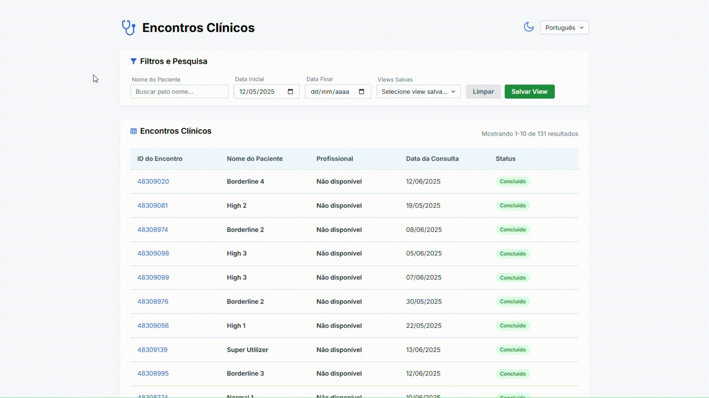
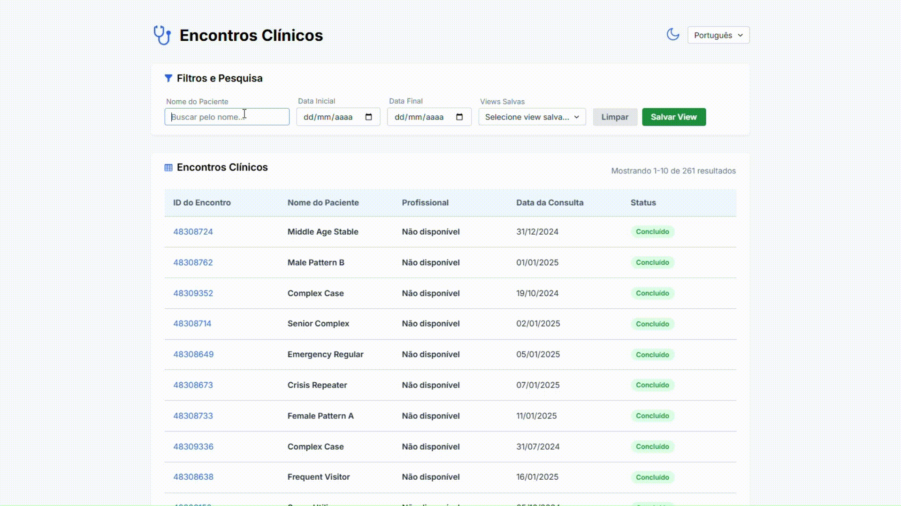

# FHIR Clinical Encounters — React Application

A responsive React application for exploring clinical encounter data from a public **FHIR R4 API**.

Built as a technical challenge, this project demonstrates API integration, data filtering, pagination, state management, automated testing, and user-focused interface design.

**[Live Demo](https://fhir-encounters-frontend.vercel.app/)**

## Overview

The application retrieves clinical encounters from a public FHIR server and presents them in an interactive, searchable interface. Users can explore encounter details, filter results, navigate paginated records, and save preferred filter configurations.

## Features

### Clinical encounters
- Retrieve clinical encounters from a public FHIR R4 API
- Display patient, practitioner, date, and encounter information
- View encounter details in a modal
- Handle missing or unavailable data

### Search and pagination
- Filter by patient name and date range
- Debounced search to optimize API requests
- API-based pagination with 10, 25, or 50 records per page
- Numbered page navigation

### User experience
- Responsive desktop and mobile layouts
- Light and dark themes
- Portuguese and English interfaces
- Skeleton loading states
- Error feedback and retry handling
- Saved filter views persisted in localStorage

### Testing
- Unit tests with Jest, including data formatting utilities
- ESLint configuration

## Tech Stack

| Category | Technologies |
| --- | --- |
| Frontend | React 19, JavaScript ES6+ |
| Build | Vite 7 |
| Styling | CSS3, BEM |
| State | Context API, React Hooks |
| Testing | Jest, Babel |
| Quality | ESLint |
| Deployment | Vercel |
| Data | Public FHIR R4 API |

## Screenshots

### Main interface


### Dark mode


### Encounter details


### Mobile layout


## Feature Demonstrations

### Initial loading


### Theme switching


### Patient filtering


### Date filtering


### Pagination


### Language switching


### Saved views


## FHIR API Integration

The application consumes a public FHIR R4 endpoint:

```text
https://hapi.fhir.org/baseR4/Encounter
```

Example query:

```text
/Encounter?status=finished&date=ge2025-01-01&_include=Encounter:patient&_include=Encounter:participant
```

Working with a public healthcare API introduces challenges such as variable response times, incomplete fields, nested FHIR resources, and temporary API unavailability. The application includes loading states, error handling, and data formatting utilities to improve usability.

## Architecture

The application uses reusable UI components, shared state, custom hooks, services for API communication, and data transformation utilities.

```text
React UI
  |
Components and Context
  |
Custom Hooks / Services
  |
Public FHIR R4 API
```

## Getting Started

Requires Node.js and npm.

```bash
git clone https://github.com/jlcambraia/fhir-encounters-frontend.git
cd fhir-encounters-frontend
npm install
npm run dev
```

Open the local URL displayed by Vite.

Build and preview:

```bash
npm run build
npm run preview
```

## Running Tests

```bash
npm test
```

## Engineering Highlights

- Integration with a standardized healthcare data API
- Handling complex asynchronous data
- Reusable React component architecture
- State management with Context API and custom hooks
- API pagination and debounced filtering
- Persistent user preferences
- Internationalization
- Automated unit testing
- Responsive UI development

## Potential Improvements

- Expanded component and integration tests
- Additional accessibility testing
- More comprehensive FHIR resource support
- Improved API caching strategies
- Additional filtering and reporting features

## Author

**João Luiz Cambraia** · [GitHub](https://github.com/jlcambraia) · [LinkedIn](https://www.linkedin.com/in/joaoluizcambraia/)
